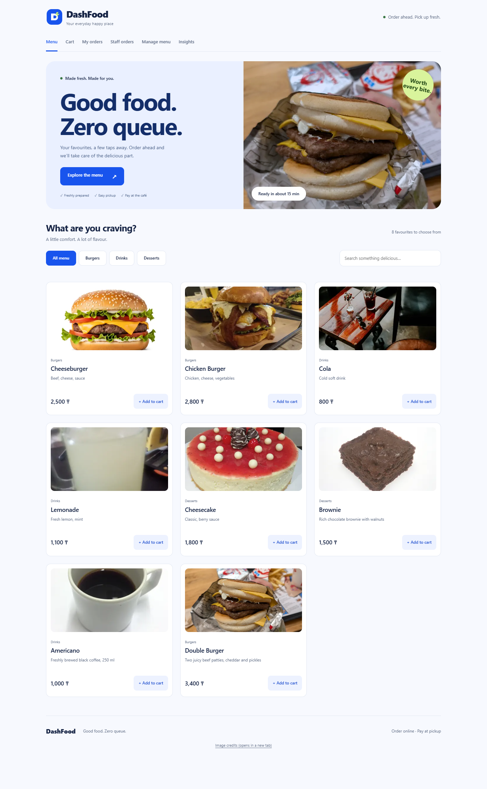
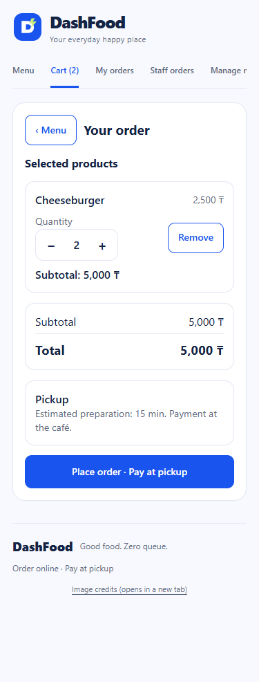
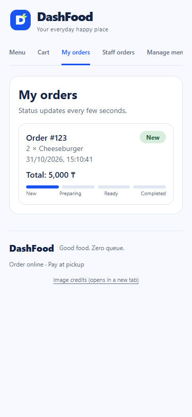
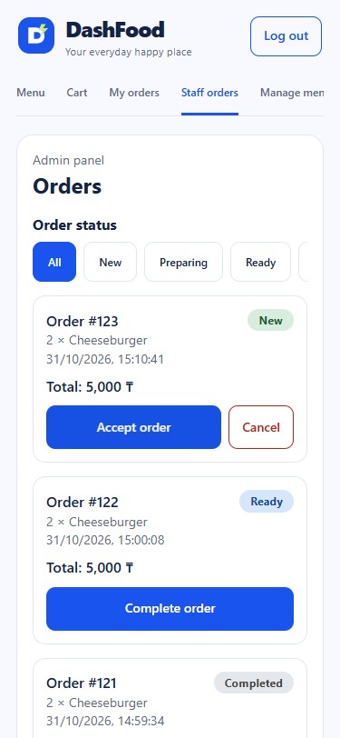
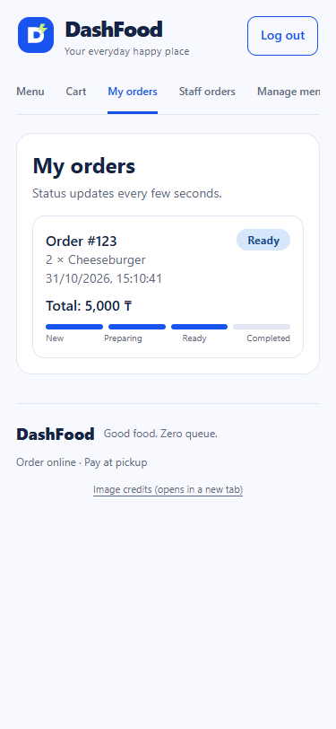
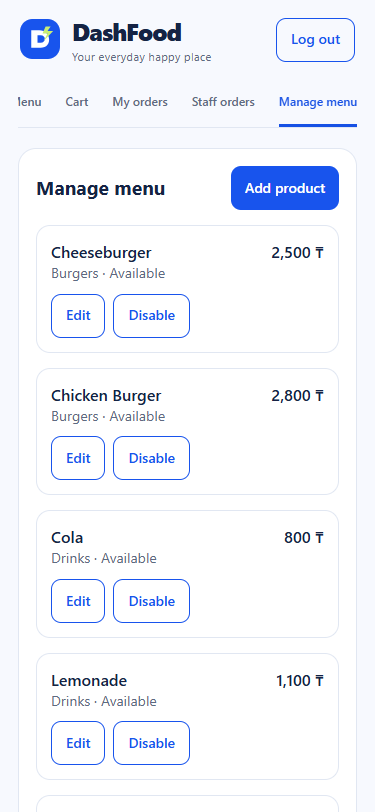
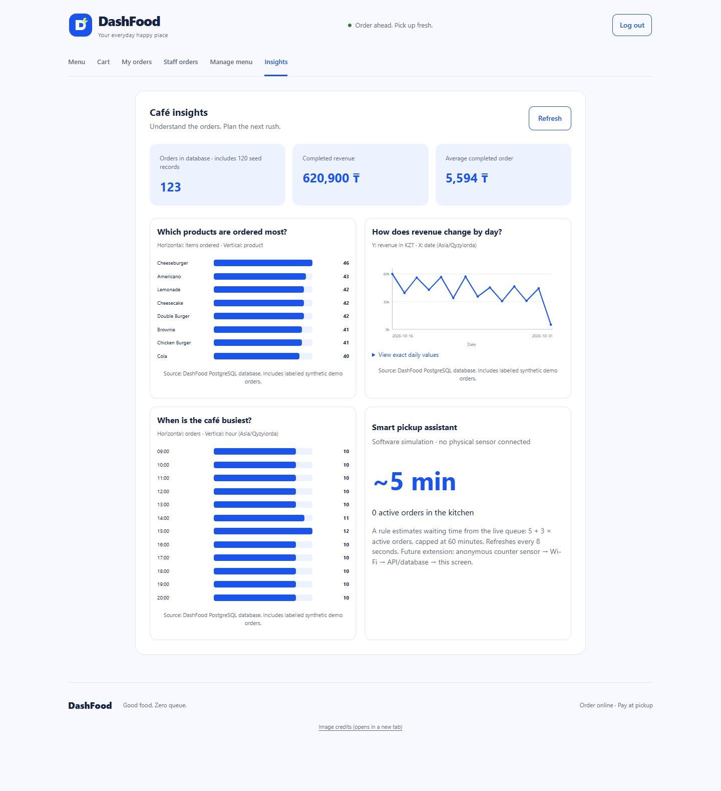

# DashFood — Project Stage 2 (Endterm)

**Group:** [enter group] · **Team:** [enter registered team name]  
**Members:** Artur — UI Designer; Adiyat — Analyst / Developer; Erdaulet — Researcher / Presenter.  
**Version:** 31 October 2026. **Submission status:** draft pending external user testing and team verification.

DashFood is a café pickup ordering system. Customers choose products, check quantities
and totals, submit orders and track preparation. Staff manage orders and menu availability.
The project uses React/TypeScript, Express and PostgreSQL. Payment takes place at pickup.
The prototype contains generated test data; it is not a record of a real café's customers.

## Part A — Working prototype (30 points)

### A1. End-to-end journeys

Customer: open Menu → check product and price → add to Cart → adjust quantity/remove
an item → Place order → view status in My orders. Orders are inserted into PostgreSQL
orders and order_items in one transaction. The server reads product prices from products.
Staff: log in → open Staff orders → accept New order → mark Ready → complete.
Staff may also add/edit/disable menu products. Customer screens read the updated data.

Screenshots below are actual browser captures from the local database-backed prototype.
The capture scripts create synthetic verification orders. Full-resolution images and
machine-readable check results are in output/evidence.













### A2. Requirement status

Requirements R1–R15 are transcribed from the supplied Stage 1 image. R11 is partly
cropped; disabling products is inferred from its visible “Disable test product” test.
No requirement has been deliberately removed. Brand, desktop layout and analytics
were added for DashFood and Stage 2.

| ID | Requirement | Priority | Status | Evidence | Change / explanation |
|---|---|---|---|---|---|
| R1 | User can view café menu | Must | Done | A1-1; browser test | Responsive menu added |
| R2 | User can view product prices | Must | Done | A1-1; API product list | KZT displayed |
| R3 | User can add product to cart | Must | Done | A1-2; browser test | Feedback added |
| R4 | User can remove product from cart | Must | Done | Cart remove control; manual demo | Unavailable items can also be removed |
| R5 | User can change product quantity | Should | Done | A1-2; browser test | Range 1–50, persisted after refresh |
| R6 | User can place an order | Must | Done | A1-3; API verification | Server calculates price; transaction |
| R7 | User can view order status | Should | Done | A1-5 | Refresh every 8 seconds |
| R8 | Administrator can view incoming orders | Must | Done | A1-4; API staff check | JWT-protected endpoint |
| R9 | Administrator can change order status | Must | Done | A1-4/A1-5; API transitions | Workflow prevents skipped stages |
| R10 | Administrator can add/edit products | Should | Done | A1-6; API create/edit check | Form and backend validation |
| R11 | Administrator can disable products (confirm cropped text) | Must | Done for inferred requirement | API disabled-product checks | Original full sentence must be verified |
| R12 | Menu/cart load in less than 2 seconds | Must / NFR | Done in automated Fast 4G measurement | performance.json | Attach manual Network-panel evidence for B3 |
| R13 | Customer/server communication uses HTTPS | Must / NFR | Partly: local TLS configured; trust/deployment pending | Caddyfile; local HTTPS health check | Local CA must be trusted; public domain not deployed |
| R14 | Order in no more than 5 main steps | Must / NFR | Done in UI; external validation pending | Menu → Add → Cart → Place order | Four main actions for a simple order |
| R15 | At least 99% availability | Must / NFR | Partly: infrastructure configured; uptime unmeasured | Healthcheck, restart policy | Requires a defined monitoring period |

### A3. Deployment and security

Exact launch instructions are in README.md. Run setup.ps1 with Docker Desktop open,
then visit http://localhost:4000. Database state persists in a named Docker volume.
Optional Caddy serves https://localhost; a local CA requires explicit trust on the client.
Public HTTPS deployment and measured uptime are not claimed.

Passwords are hashed with bcrypt. Staff receive an expiring JWT; admin endpoints check
its signature and admin role. A guest request to GET /api/orders returns 401.
Parameterised SQL and server validation protect data operations. Prices are retrieved
from the database, ignoring browser-supplied totals. Login attempts and JSON body size
are limited. Status updates follow New → Preparing → Ready → Completed, with
cancellation from New/Preparing. The automated checks demonstrate these boundaries.

The prototype avoids collecting names, phone numbers, addresses or payment details.
Cart state and order IDs are stored in the customer's browser. Order IDs are sequential
and order lookup exposes item/status information; stronger tracking tokens or account
ownership would be needed before collecting personal customer data. Device/session
storage should not be treated as cross-device identity. The Stage 1 / Assignment 3
privacy report and instructor annotations were not provided and must be cross-checked.

### A4. Remaining work and contributions

| Work before Week 10 | Responsible role | Deadline / verification |
|---|---|---|
| Test three criteria with 3 non-team users; document real issues | Artur + Erdaulet | Before submission; fill B1/B2 |
| Three Fast 4G runs for Menu and Cart | Erdaulet | Before submission; attach Network screenshots |
| Confirm full R11 and instructor corrections | Adiyat | Before submission; compare Stage 1 |
| Trust local certificate / deploy domain HTTPS | Adiyat | Before public demo; show trusted browser connection |
| Collect uptime observations for R15 | Adiyat + Erdaulet | Start now, report actual period in Week 10 |
| Replace temporary logo with supplied brand asset | Artur | When logo arrives; rebuild |
| Finish report identifiers, evidence and LMS upload | All members | Course deadline; date to be entered by team |

The following reflects roles supplied by the team. Each member must confirm what they
personally produced since Stage 1; the table does not certify unverified individual work.

| Member | Declared responsibility | Requirements/charts/presentation to explain |
|---|---|---|
| Artur — UI Designer | UI/UX, wireframes, usability analysis, core components | R1–R5/R14; customer demo; usability and responsive design |
| Adiyat — Analyst / Developer | Requirements, architecture, data flow | API/DB, R6–R13; SQL and charts C1–C3; staff demo |
| Erdaulet — Researcher / Presenter | Evaluation, impact, future scaling | Success criteria, performance, IoT research, limitations and Week 10 plan |

## Part B — Testing (15 points)

### B1. Stage 1 success criteria

The team confirms that the three most important requirements are its success criteria:
“viewing the menu”, “adding products to the cart” and “placing an order”.
The slide gives qualitative outcomes, not numerical timing targets. We preserve that
scope and separately test the explicit R12/R14 performance/step requirements.

| Criterion | Expected outcome | Automated result | External user result |
|---|---|---|---|
| Viewing the menu | Available products and prices can be seen | Passed browser/API checks | Pending U1/U2/U3 |
| Adding products to the cart | Selected products, quantities and total can be checked | Passed browser checks | Pending U1/U2/U3 |
| Placing an order | Order is saved and available to staff | Passed browser/API checks | Pending U1/U2/U3 |

No non-team participants have been tested by the development agent. Complete the
participant/device/task/measurement table in docs/TESTING.md with at least three
real people; do not present automated tests as human usability evidence.

### B2. Usability findings

Three observed user problems and corresponding Nielsen heuristics must be added
after external testing. TESTING.md provides the table. Engineering improvements already
include visible add-to-cart feedback (visibility of system status), remove/quantity controls
(user control and freedom) and validation/unavailable-item handling (error prevention).
These are implementation choices, not fabricated participant observations.

### B3. Performance

Use browser Network with cache disabled and Fast 4G for at least three runs per main
screen; record run values and average in TESTING.md. Automated measurements use
Chrome DevTools Protocol with cache disabled and the current DevTools Fast 4G
parameters: 1,012,500 bytes/s download, 168,750 bytes/s upload, 165 ms latency.
Viewport: 375 by 812, DPR 1. Each screen was loaded three times.

| Screen | Ready run 1, s | Ready run 2, s | Ready run 3, s | Average ready, s | Average Load, s |
|---|---|---|---|---|---|
| Menu | 1.856 | 1.351 | 1.318 | 1.508 | 0.872 |
| Cart | 1.196 | 1.186 | 1.189 | 1.190 | 0.872 |

Ready means the menu cards or cart controls are observable in the browser, timed from
navigation start. It is not human task-completion time. Both averages meet R12 in
these local conditions. This is an automated equivalent; attach actual Network-panel
screenshots for the course's requested evidence. JSON and screen captures are in
output/evidence/performance.json and B3-*.png. Network preset source:
[Chrome DevTools NetworkManager](https://chromium.googlesource.com/devtools/devtools-frontend/+/HEAD/front_end/core/sdk/NetworkManager.ts).

## Part C — Data analysis (20 points)

### C1–C2. Questions and repeatable method

The main table orders is seeded with 120 synthetic records over 14 dates, with related
order_items, varying quantities and a repeatable distribution. is_demo=TRUE identifies
the seed batch. Manual demos and automated verification add further test orders.
Run the exact SQL in docs/ANALYSIS.sql using PostgreSQL psql. GET /api/analytics runs
the same GROUP BY/SUM/COUNT queries to populate the product screen.

1. Which products are ordered most? SUM(order_items.qty), grouped by item name,
   excluding Cancelled orders; compare the top eight products with horizontal bars.
2. How does completed revenue change by day? SUM(orders.total), grouped by local
   date, including only Completed orders; display the latest 14 dates as a line chart.
3. When is the café busiest? COUNT(orders), grouped by hour in Asia/Qyzylorda;
   compare hourly demand with horizontal bars. This includes cancelled orders because
   placing an order still represents an incoming request.

The local date/hour conversion is explicit, so UTC storage does not shift the analysis
accidentally. Revenue excludes cancelled and unfinished orders. A cancelled order
therefore affects demand counts but does not count as completed revenue.

SQL for question 1:

```sql
SELECT i.name, SUM(i.qty) AS items_ordered
FROM order_items i JOIN orders o ON o.id = i.order_id
WHERE o.status <> 'Cancelled'
GROUP BY i.name ORDER BY items_ordered DESC LIMIT 8;
```

SQL for question 2 (reverse the returned rows for chronological plotting):

```sql
SELECT to_char(created_at AT TIME ZONE 'Asia/Qyzylorda',
               'YYYY-MM-DD') AS day, SUM(total) AS revenue_kzt
FROM orders WHERE status = 'Completed'
GROUP BY day ORDER BY day DESC LIMIT 14;
```

SQL for question 3:

```sql
SELECT to_char(created_at AT TIME ZONE 'Asia/Qyzylorda',
               'HH24:00') AS hour, COUNT(*) AS orders
FROM orders GROUP BY hour ORDER BY hour;
```

### C3–C5. Charts, interpretation and product integration



Each chart has a question as its title, labelled dimensions/units and a source note.
The revenue line also provides an expandable table of exact values. Values may change
after new test orders; this is expected for a live database. For fixed results add
AND is_demo to the source query and record the extraction date.

**Interpretation (150–200 words):**

The DashFood analysis demonstrates three repeatable views of the same order database. Product totals compare the quantities ordered for each menu item, while daily completed revenue shows how order values change across dates. Hourly counts describe when requests enter the system. These measures answer different operational questions: popularity concerns preparation quantities, revenue concerns completed sales, and hourly demand concerns staffing. Cancelled orders are excluded from product popularity and revenue, but remain in the incoming-request count. An administrator could use a real version of these results to schedule an additional kitchen worker during a consistently busy period, then check whether preparation delays decrease. In this prototype, however, the main dataset consists of 120 generated orders, supplemented by development verification orders. Its regular patterns come from the seed algorithm and do not establish actual customer preferences, genuine peak hours or commercial performance. The short date range, limited menu and absence of measured preparation timestamps further restrict conclusions. The charts therefore validate the query and display method, while real operational decisions require representative observations over a longer period.

## Part D — Smart technologies and IoT (15 points)

### D1. A real food-service example (150–200 words)

Connected refrigerator monitoring is a practical IoT application in food service. Testo Saveris 2 uses temperature probes and Wi-Fi data loggers to monitor refrigerated storage. According to the manufacturer, readings are transmitted through a wireless LAN to the Testo Cloud, where staff can review measurements using an internet-connected device. Configurable alerts inform staff when a limit is exceeded. The manufacturer's food application example specifically discusses monitoring during the processing, storage and sale of food, including restaurant environments. This provides a concrete connection between physical sensors, a network, remote processing and a staff-facing application. A second source, the FDA, explains why reliable refrigerator temperature monitoring matters for food storage and recommends checking conditions with a thermometer. Together these sources support the operational purpose of a connected monitoring system. For DashFood, such monitoring could complement ordering by helping staff detect refrigeration problems before affected ingredients are offered. That proposed connection is our inference, not a claim of an existing integration. One risk is interrupted connectivity: a dashboard that stops receiving updates could otherwise be mistaken for evidence that storage conditions remain normal.

Sources: [Testo food application example](https://static.testo.com/image/upload/v1692757381/HQ/testo-saveris-2-example-application-food-en.pdf),
[Testo Saveris 2-T3](https://www.testo.com/en-UK/testo-saveris-2-t3/p/0572-2033),
[FDA refrigerator thermometers](https://www.fda.gov/food/buy-store-serve-safe-food/refrigerator-thermometers-cold-facts-about-food-safety).

### D2. Proposed extension: anonymous pickup counter occupancy

DashFood could combine its existing active-order count with an anonymous counter
occupancy measurement, helping staff warn customers when pickup is crowded.
The physical device is a time-of-flight counter, not a camera. No face images, phone
identifiers, names or location histories are needed. A proposed JSON message contains
device_id, timestamp, count and sequence number, approximately 100 bytes per reading.
One message every 10 seconds is about 8,640 readings / 0.86 MB of raw JSON per day,
excluding protocol overhead, retries and indexes. Aggregate by minute, retain detailed
data 7 days and aggregates 30 days. These are proposed design choices, not deployed policy.

Four-layer diagram, connected to the existing database:

```text
1 DEVICE / SENSOR
Anonymous time-of-flight pickup counter
    | count + timestamp, every 10 seconds
    v
2 NETWORK
Wi-Fi (WPA2/WPA3) + HTTPS, per-device credentials
    |
    v
3 PROCESSING / CLOUD
Authenticated ingestion API -> validate/deduplicate -> proposed sensor_readings table
                                                     |
                              existing PostgreSQL <--+--> existing orders table
                                                     |
                              crowd/queue rule <-----+
    |
    v
4 APPLICATION
DashFood staff Insights -> crowd warning / waiting estimate
Customer screen receives an aggregate warning only
```

The new occupancy/time information can reveal presence patterns even without names.
Do not link readings to order IDs, accounts or staff shifts. Authenticate devices, rotate
credentials, enforce TLS, limit ingestion rate, reject replayed sequences and impossible
counts, restrict raw readings to staff, and display stale-data warnings when updates stop.
Update the Assignment 3 privacy analysis before deploying this extension. A real sensor,
ingestion route and sensor_readings table are proposed future work, not existing features.

### D3. Current smart demonstration

The running Insights screen already demonstrates a software rule on live order data:
estimated wait = min(60, 5 + 3 × count(New or Preparing orders)), in minutes.
It refreshes every 8 seconds and reacts when staff progress the queue. The screen is
explicitly labelled a software simulation with no physical sensor. This is a lightweight
smart-rule demonstration, not a claim that the proposed IoT hardware is implemented.

## References and submission checklist

- Course document: Project Stage 2 (End-term), supplied Endterm_Week_9 (1).pdf.
- Team Stage 1 screenshots: three key requirements and R1–R15 requirements table.
- [Express security guidance](https://expressjs.com/en/advanced/best-practice-security/).
- [PostgreSQL transactions](https://www.postgresql.org/docs/current/tutorial-transactions.html).
- Testo and FDA primary sources linked in D1. Accessed 31 October 2026.
- Existing media credits: web/public/media/credits.html; previous Assignment 4 reports retained.

Before LMS submission: fill group/team identifiers; confirm contributions; include Stage 1
annotations; add B1 external results, B2 findings and B3 Network evidence; verify full R11;
confirm HTTPS trust and report actual availability observations; check PDF screenshots;
rename the final completed PDF Group_Team_ICT_ProjectStage2.pdf; one submission per team.
Prepare 6–10 slides and a live 5–7 minute presentation. docs/DEFENSE_RU.md gives
an eight-slide plan and individual explanation prompts. The exported report remains a
draft until the missing real-world evidence has been entered.
